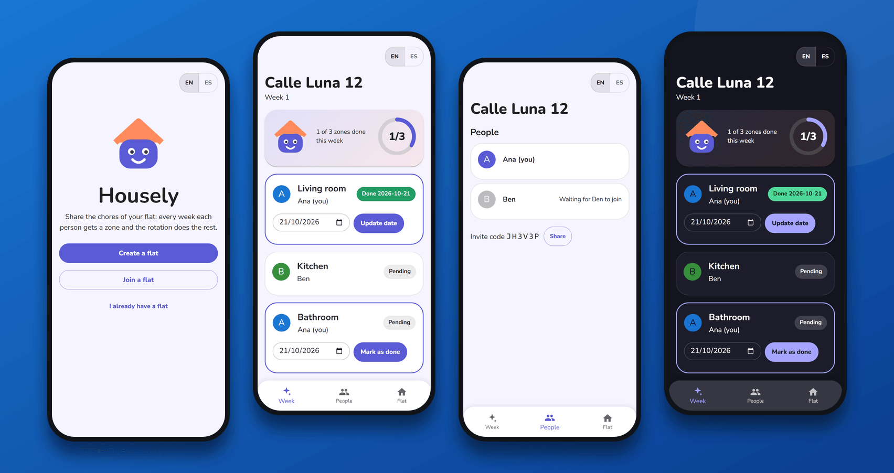
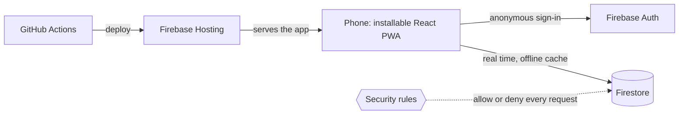

<p align="center">
  
</p>

<h1 align="center">Housely</h1>

<p align="center">
  <strong>Fair weekly chores for your flat.</strong><br />
  Everybody cleans every zone, in turn. Create the flat, share a code, tick what is done.
</p>

<p align="center">
  <a href="https://housely-prod.web.app"><strong>Try it</strong></a> ·
  <a href="docs/implementation/user-manual.adoc">User manual</a> ·
  <a href="docs/README.adoc">Documentation</a> ·
  <a href="https://github.com/Glinbor10/housely/releases">Releases</a>
</p>

<p align="center">
  <a href="https://github.com/Glinbor10/housely/actions/workflows/merge-main.yml"></a>
  <a href="https://github.com/Glinbor10/housely/releases"></a>
  <a href="LICENSE"></a>
  
  
  
  
</p>

## Why Housely

It started with an everyday problem: three flatmates, three shared zones (the living room, the kitchen and the bathroom) and the eternal question of **whose turn is it?** Housely answers it. Every week each person gets a zone, the rotation guarantees that over a full cycle everybody cleans everything the same number of times, and everyone sees in real time who has already done their part.

It is built to be used for real, every week, in a real flat: it installs on the phone like an app, it works without a connection and nobody has to create an account.

## What it does

- **A fair rotation.** Any number of people and zones: with 3 zones and 4 people, one person rests each week and over four weeks everybody has cleaned every zone once.
- **Share the flat in seconds.** A 6 character invite code, shared with the phone's own share sheet (WhatsApp, Messages...). Whoever joins just picks their name.
- **Tick it and see it live.** Mark a zone as done (the date is today, and you can correct it). Everybody sees it instantly, with a progress bar for the week.
- **Works offline.** Open the flat and mark things in the lift with no signal; it syncs when the connection comes back.
- **Tricount in one tap.** The owner adds the link of your Tricount and everyone opens it from the app.
- **Lost phone? No problem.** The owner can release a flatmate so they rejoin from a new phone, keeping what they already cleaned.
- **Made for phones.** Installable on Android and iPhone, light and dark mode, comfortable touch targets and safe-area support.

## How the rotation works

Nothing about the assignment is stored: it is computed, so adding or removing people or zones never breaks the history.

`member = members[(week + zoneIndex) % members.length]`

Four people and three zones, week by week:

| Week | Living room | Kitchen | Bathroom | Rests |
| ---- | ----------- | ------- | -------- | ----- |
| 1    | Ana         | Ben     | Carla    | Dani  |
| 2    | Ben         | Carla   | Dani     | Ana   |
| 3    | Carla       | Dani    | Ana      | Ben   |
| 4    | Dani        | Ana     | Ben      | Carla |

After four weeks everybody has cleaned each zone exactly once. Tests prove this property for every combination from 1 to 7 people and 1 to 7 zones. See [`src/domain/rotation.ts`](src/domain/rotation.ts).

## Under the hood

There is no server of our own: the app talks straight to Firebase, and [Firestore security rules](firebase/firestore/firestore.rules) decide who can read and write what.



Engineering highlights:

- **Test-driven, in layers.** Unit and component tests, architecture tests that stop the layers from depending on each other, the Firestore rules tested against the emulator, and real-browser tests on **Android (Chromium) and iPhone (WebKit)** that run on every pull request.
- **Secure by design.** Strict Content-Security-Policy with no violations, restricted API keys, abuse limits in the rules (flats per identity, people per flat) and no secret anywhere in the history.
- **Delivery.** Every PR gets its own preview deployment; every merge is deployed and re-tested; releases are versioned from git tags and verified in production with a smoke test.
- **Documented** with a tailored [Métrica v3](docs/README.adoc) structure: requirements traced to tests, decisions recorded as ADRs.

## Run it locally

You need Node 24 and Java 21 or newer (the Firestore emulator uses it). No credentials are needed: local work runs against the Firebase emulators.

```bash
npm install
npm run dev          # the app and the emulators: http://localhost:5173
npm test             # unit and component tests
npm run test:rules   # emulator tests: rules, data layer and the whole app
npm run e2e          # real-browser tests, with E2E_BASE_URL set to a deployed environment
npm run screenshots  # regenerates the images of this README from the real app
```

Change the logo by replacing `public/logo.svg` and running `npm run icons`: every icon and the link preview card are regenerated.

## Delivery

- **PR**: lint, formatting, types, tests with coverage, build, a Firebase preview and real-browser tests on Android and iPhone
- **Merge to `main`**: the same checks, deployed to the CI environment
- **Release** (manual workflow): version derived from git tags, deployed to production, GitHub Release created

See the [versioning and release procedure](docs/implementation/versioning-and-release.adoc) and [CONTRIBUTING.md](.github/CONTRIBUTING.md).

## License

[PolyForm Noncommercial 1.0.0](LICENSE): the source is available and free for any noncommercial use. Commercial use and selling the product are reserved to the author.
