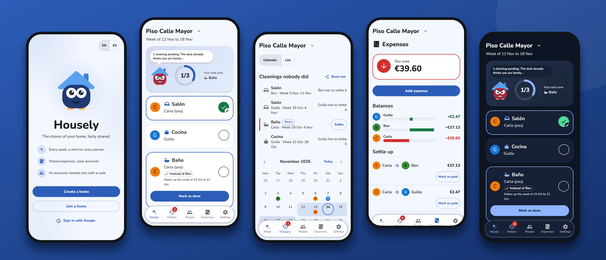
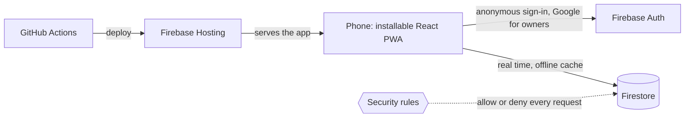

<p align="center">
  
</p>

<h1 align="center">Housely</h1>

<p align="center">
  <strong>Fair weekly chores for your home.</strong><br />
  Everybody cleans every zone, in turn. Create the home, share a code, tick what is done and split the expenses.
</p>

<p align="center">
  <a href="https://housely-prod.web.app"><strong>Try it</strong></a> ·
  <a href="docs/implementation/user-manual.adoc">User manual</a> ·
  <a href="docs/README.adoc">Documentation</a> ·
  <a href="https://github.com/Glinbor10/housely/releases">Releases</a>
</p>

<p align="center">
  <a href="https://github.com/Glinbor10/housely/actions/workflows/merge-main.yml"></a>
  <a href="https://github.com/Glinbor10/housely/releases"></a>
  <a href="LICENSE"></a>
  
  
  
  
</p>

## Why Housely

It started with an everyday problem: three housemates, three shared zones (the living room, the kitchen and the bathroom) and the eternal question of **whose turn is it?** Housely answers it. Every week each person gets a zone, the rotation guarantees that over a full cycle everybody cleans everything the same number of times, and everyone sees in real time who has already done their part.

It is built to be used for real, every week, in a real home: it installs on the phone like an app (open it in Chrome and choose "Install"; an Android APK is still in testing), it works without a connection and your housemates do not need an account: they join with a code. Whoever creates the home signs in with Google, so the home can always be found again from a new phone.

## What it does

- **A fair rotation.** Any number of people and zones: with 3 zones and 4 people, one person rests each week and over four weeks everybody has cleaned every zone once.
- **Share the home in seconds.** A 6 character invite code, shared with WhatsApp, Telegram, email or the phone's own share sheet. Whoever joins picks their name and a free color.
- **Tick it and see it live.** Mark a zone as done (the date is today, and you can correct it or undo it). Everybody sees it instantly, with a progress ring for the week and Housy the mascot reacting to how the week goes.
- **Five sections.** Week, History, People, Expenses and Settings. The History tab shows a month calendar of who cleaned what, week by week, and a badge when you have cleanings to settle.
- **Cleanings nobody did get settled.** Done late, covered by a housemate, "I was not at home", or made up by taking a later cleaning of somebody else. Everybody can see how each one was settled.
- **Shared expenses.** Add expenses and payments, split them equally or between some people, see the balances and who pays whom to settle up. The owner can set a period after which the expenses reset, and share a summary on WhatsApp. A [Tricount](https://tricount.com) link is still available as a shortcut.
- **Works offline.** Open the home and mark things in the lift with no signal; it syncs when the connection comes back.
- **Several homes, one account.** Keep more than one home on the device and switch between them. Sign in with Google and your homes come back on any phone.
- **Lost phone? No problem.** With Google your homes come back. Without it, the owner can release a housemate so they rejoin from a new phone, keeping what they already cleaned. A housemate who signs in to an existing Google account brings their homes along.
- **The owner is in charge.** Edit people and zones (the change applies from next week and never rewrites past weeks), rename the home, hand it over to a housemate who has Google linked, or delete it for good.
- **Spanish and English, light and dark.** Installable on Android and iPhone, comfortable touch targets and safe-area support. The back button closes dialogs and goes back through the sections.

## How the rotation works

Nothing about the assignment is stored: it is computed, so adding or removing people or zones never breaks the history.

`member = members[(week + zoneIndex) % members.length]`

Four people and three zones, week by week:

| Week | Living room | Kitchen | Bathroom | Rests |
| ---- | ----------- | ------- | -------- | ----- |
| 1    | Ana         | Ben     | Carla    | Dani  |
| 2    | Ben         | Carla   | Dani     | Ana   |
| 3    | Carla       | Dani    | Ana      | Ben   |
| 4    | Dani        | Ana     | Ben      | Carla |

After four weeks everybody has cleaned each zone exactly once. Tests prove this property for every combination from 1 to 7 people and 1 to 7 zones. See [`src/domain/rotation.ts`](src/domain/rotation.ts).

## Under the hood

There is no server of our own: the app talks straight to Firebase, and [Firestore security rules](firebase/firestore/firestore.rules) decide who can read and write what.



Engineering highlights:

- **Test-driven, in layers.** Unit and component tests, architecture tests that stop the layers from depending on each other, the Firestore rules tested against the emulator, and real-browser tests on **Android (Chromium) and iPhone (WebKit)** that run on every pull request.
- **Secure by design.** Strict Content-Security-Policy with no violations, App Check, restricted API keys, abuse limits in the rules (homes per identity, people per home) and no secret anywhere in the history.
- **Delivery.** Every PR is checked against the Firebase emulators in real browsers; every merge is deployed to a CI environment and re-tested; releases are versioned from git tags and verified in production with a smoke test.
- **Documented** with a tailored [Métrica v3](docs/README.adoc) structure (the Spanish public administration's software methodology): requirements traced to tests, decisions recorded as ADRs.

## Run it locally

You need Node 24 and Java 21 or newer (the Firestore emulator uses it). No credentials are needed: local work runs against the Firebase emulators.

```bash
npm install
npm run dev          # the app and the emulators: http://localhost:5173
npm test             # unit and component tests
npm run test:rules   # emulator tests: rules, data layer and the whole app
npm run e2e          # real-browser tests, with E2E_BASE_URL set to a deployed environment
npm run screenshots  # regenerates the images of this README from the real app
```

Change the logo by replacing `public/logo.svg` and running `npm run icons`: every icon and the link preview card are regenerated.

## Delivery

- **PR**: lint, formatting, types, tests with coverage, build, the Firestore rules tests and real-browser tests on the emulators
- **Merge to `main`**: the same checks, deployed to the CI environment
- **Release** (manual workflow): version derived from git tags, deployed to production, GitHub Release created

See the [versioning and release procedure](docs/implementation/versioning-and-release.adoc) and [CONTRIBUTING.md](.github/CONTRIBUTING.md).

### Run your own copy

You need your own Firebase project (Spark plan is enough), then the variables, environments and secrets that the workflows read. They are listed in [configuration management](docs/configuration-management/configuration-management.adoc).

## Roadmap, contributing and security

- **Roadmap:** the [milestones](https://github.com/Glinbor10/housely/milestones) group the issues by version.
- **Contributing:** issues and pull requests are welcome. Read [CONTRIBUTING.md](.github/CONTRIBUTING.md) first: every change starts from an issue and goes through a pull request.
- **Security:** please do not open a public issue; follow [SECURITY.md](.github/SECURITY.md) and use GitHub's private vulnerability reporting.

## License

[PolyForm Noncommercial 1.0.0](LICENSE): the source is available and free for any noncommercial use. Commercial use and selling the product are reserved to the author. This is a source-available license, not an OSI-approved open source one, which is why GitHub lists it as "Other".
